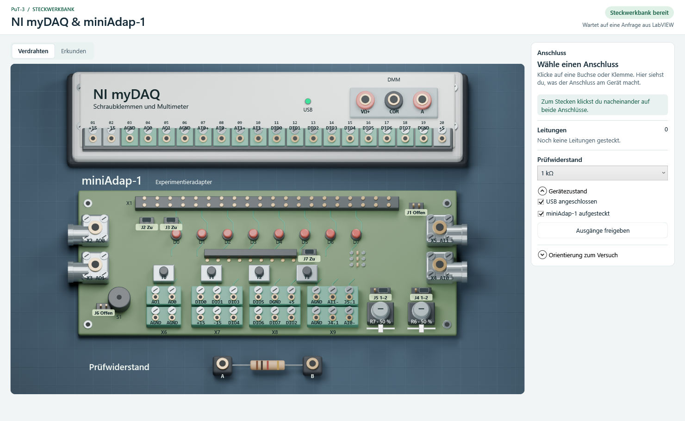

# PuT-3 Virtuelle Steckwerkbank

## Deutsch

Virtuelle Steckwerkbank für die fünf Teile der PuT-3-Hochschulübung mit NI myDAQ und miniAdap-1. Du steckst Leitungen und setzt Jumper auf dem Gerätebild. Messart, Kanal, Abtastrate und Ausgabe stellst du in LabVIEW ein.

### Start

Unter Windows x64 mit dem .NET 10 SDK aus dem Repository-Ordner bauen.

~~~powershell
dotnet publish .\Workbench\Workbench.csproj -c Release -r win-x64 --self-contained true -p:PublishSingleFile=true -p:IncludeNativeLibrariesForSelfExtract=true -p:DebugType=none -o .\Start
.\Start\PuT3.exe
~~~

In LabVIEW 2026 öffnest du danach **PuT3 Messassistent.vi**. Für eigene Blockdiagramme liegen der Express-Knoten und alle SubVIs im selben Ordner.

### Struktur

| Ordner | Inhalt |
| --- | --- |
| [LabVIEW](LabVIEW/) | Messassistent, Funktionsgenerator, SubVIs und beide Bibliotheken des Express-Knotens |
| [Workbench](Workbench/) | C#-/WPF-Anwendung und Schaltungsmodell |
| [Modelle](Modelle/) | Frei drehbares Blender-Modell der Geräte |
| [tools](tools/) | Werkzeuge für VI-Erstellung, LabVIEW-Tests und Gerätegrafik |

## English

A virtual wiring bench for all five parts of the PuT-3 lab exercise with the NI myDAQ and miniAdap-1. Wire the connectors and set the jumpers on the bench. Configure measurement type, channel, sample rate and output in LabVIEW.

### Quick start

Follow the [build command](#start) from the checkout root on Windows x64 with the .NET 10 SDK. Start `Start\PuT3.exe`, then open **PuT3 Messassistent.vi** in LabVIEW 2026. The same folder contains the Express VI and all the subVIs for your own diagrams.

### Layout

| Folder | Contents |
| --- | --- |
| [LabVIEW](LabVIEW/) | Measurement assistant, function generator, subVIs and both Express VI libraries |
| [Workbench](Workbench/) | C#/WPF application and circuit model |
| [Modelle](Modelle/) | Rotatable Blender model of the equipment |
| [tools](tools/) | VI generation, LabVIEW testing and equipment rendering tools |
